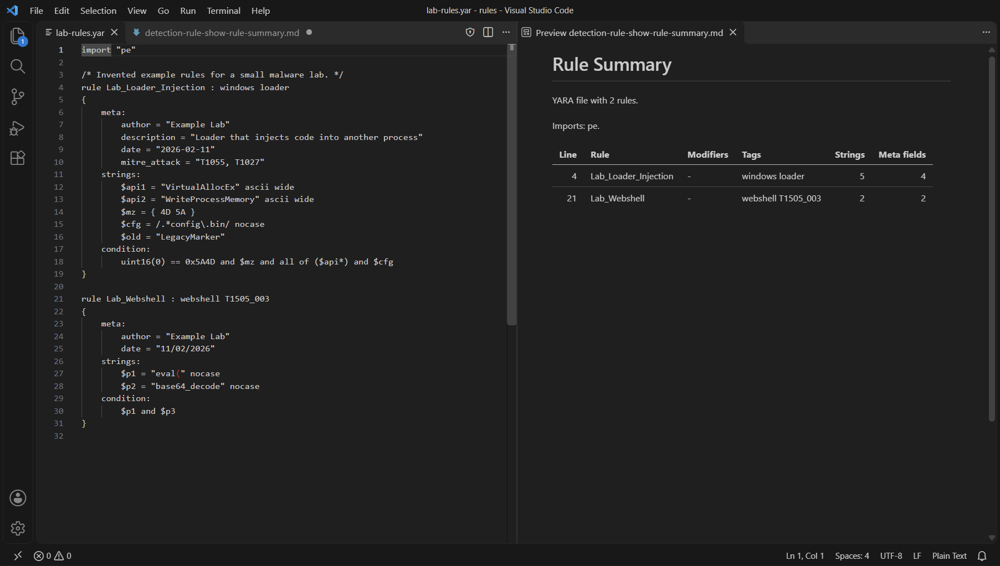
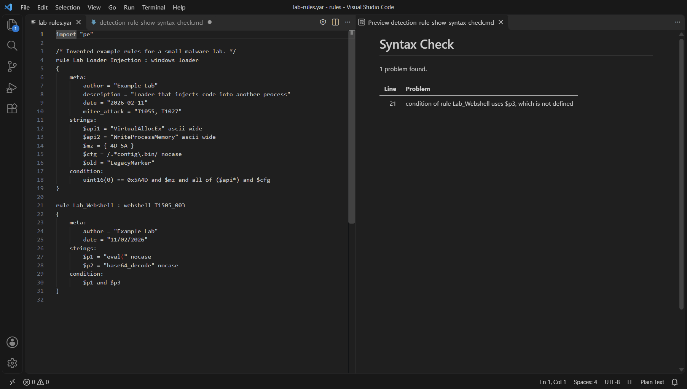
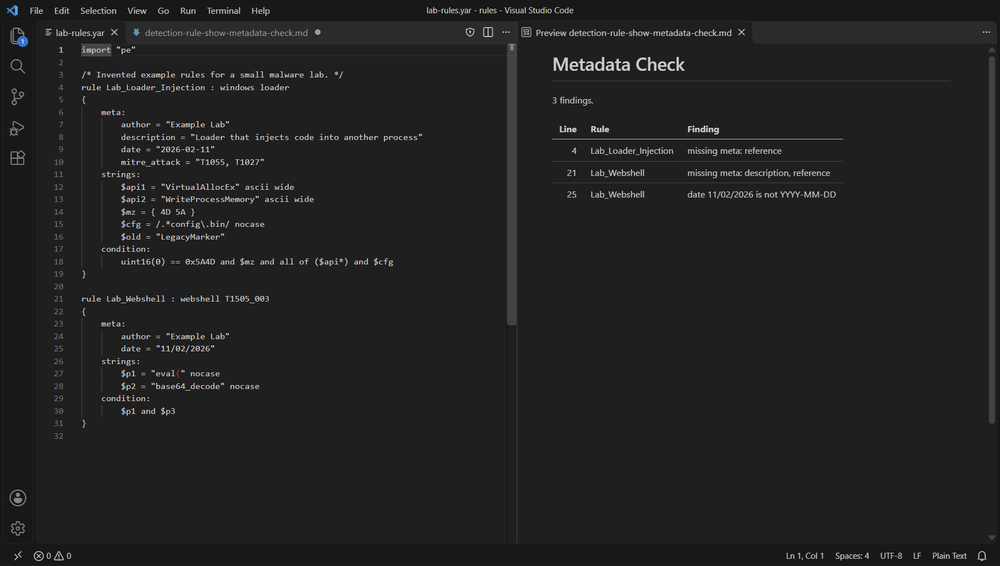
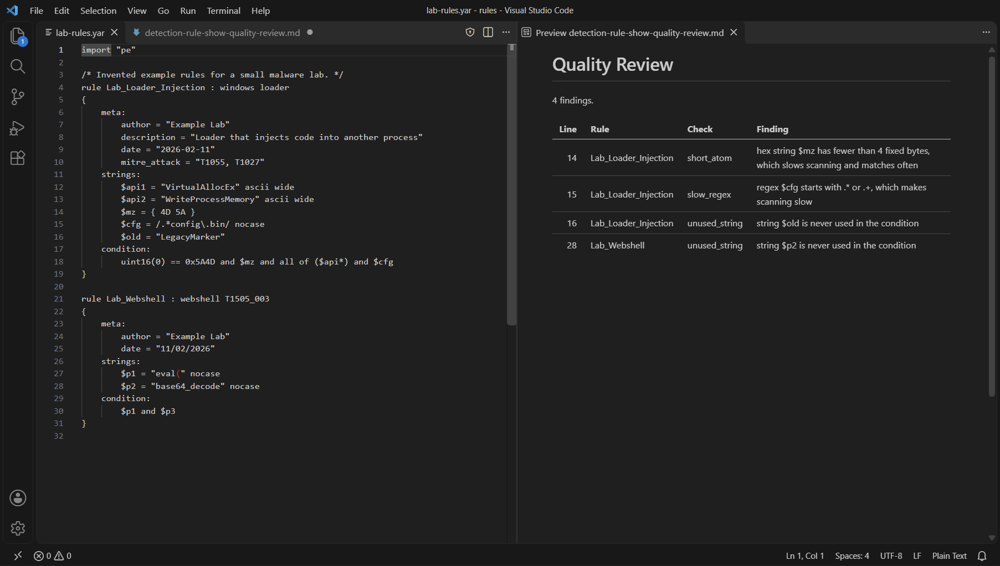
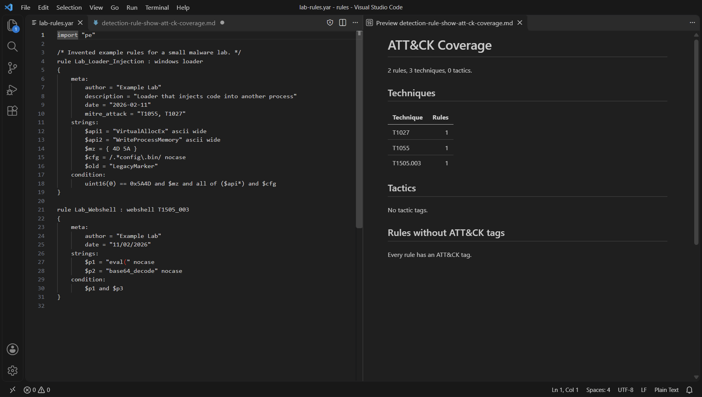

# Detection Rule Atlas

Detection Rule Atlas reads YARA rule files and Sigma rule files and turns them into clear Markdown reports: every rule with its tags, strings or log source, syntax problems such as conditions that use undefined strings or search identifiers, missing metadata, quality problems that slow scanning or match far too much, and the ATT&CK techniques and tactics the rules cover.

Everything runs on your computer. There is no telemetry. The only network request the extension ever makes is the licence check for the optional Pro tier (see [Privacy](PRIVACY.md)).

## What it does

* **Show Rule Summary**: Every rule at a glance: YARA rules with tags, strings and meta fields, or Sigma rules with status, level and log source.
* **Show Syntax Check**: Undefined strings in conditions, missing conditions, duplicates, invalid status and level values.
* **Show Metadata Check**: Missing author, description, date and reference, and ids and dates in the wrong format.
* **Show Quality Review** (Pro): Unused strings, short atoms, slow regular expressions, wildcard-only values and missing false positives.
* **Show ATT&CK Coverage** (Pro): ATT&CK techniques and tactics covered by the rules, and the rules without ATT&CK tags.

## Free, trial and Pro

| Feature | Free | Pro |
| --- | :---: | :---: |
| Show Rule Summary | yes | yes |
| Show Syntax Check | yes | yes |
| Show Metadata Check | yes | yes |
| Show Quality Review |  | yes |
| Show ATT&CK Coverage |  | yes |
| Open Sample File, walkthrough, Report A Problem | yes | yes |

The free reports need no key, no account and no network connection, and they will not be moved behind the licence key later. The first Pro command starts a **free 14-day trial** on this computer. After that, Pro is a one-time purchase, not a subscription: **Pro Personal USD 19** (one person, use at work allowed) or **Pro Business USD 39 per user** (one key per user of an organisation). A key works on up to 3 computers. The checkout page shows the final price and any taxes for your country. Licence keys are sold by Dodo Payments, the merchant of record. Details: [licence](docs/licence.md), [terms](TERMS.md).

## Commands

Open the Command Palette and type `Detection Rule Atlas`.

| Command | Tier |
| --- | :---: |
| Detection Rule Atlas: Show Rule Summary | Free |
| Detection Rule Atlas: Show Syntax Check | Free |
| Detection Rule Atlas: Show Metadata Check | Free |
| Detection Rule Atlas: Show Quality Review | Pro |
| Detection Rule Atlas: Show ATT&CK Coverage | Pro |
| Detection Rule Atlas: Open Sample File | Free |
| Detection Rule Atlas: Open Sample Sigma File | Free |
| Detection Rule Atlas: Open Walkthrough | Free |
| Detection Rule Atlas: Show Documentation | Free |
| Detection Rule Atlas: Report A Problem | Free |
| Detection Rule Atlas: Buy Pro | Free |
| Detection Rule Atlas: Enter Licence Key | Free |
| Detection Rule Atlas: Show Licence Status | Free |
| Detection Rule Atlas: Remove Licence From This Machine | Free |

## Settings

| Setting | Default | Meaning |
| --- | --- | --- |
| `detectionRuleAtlas.maxFileSizeMB` | 50 | Largest file a report reads (0.1 to 50 MB; VS Code passes files only up to 50 MB to extensions). |
| `detectionRuleAtlas.openReportsAsPreview` | true | Open each report in the Markdown preview as well. |

## FAQ

**Does Detection Rule Atlas upload my rules?**
No. Every report is created on your computer from the text in the editor, and nothing is sent anywhere.

**Does it compile YARA rules or convert Sigma rules?**
No. It reads the rule text and checks structure, references, metadata and quality patterns. Use the YARA compiler and a Sigma converter for the final check of your target platform.

**Which ATT&CK tags are read?**
Sigma tags such as attack.t1059.001 and attack.execution, and for YARA the rule tags and meta values whose key mentions mitre, attack, technique or tactic. Technique ids are shown as T1059.001; tactic names as in ATT&CK.

**Why is a short string a quality problem?**
YARA looks for short fixed byte sequences (atoms) first. Strings of fewer than 4 bytes give poor atoms, which makes scanning slow and matches far too often.

## For IT and procurement

* Publisher: SmallStepsStudio (Visual Studio Marketplace), smallstepsstudio (Open VSX).
* Network: one host, `live.dodopayments.com`, for the licence check only, and only after a key is entered. No telemetry. The trial uses no network.
* Files are read from the editor only; the extension writes no files and changes none.
* Source: <https://github.com/small-steps-studio/detection-rule-atlas>.
* Licence agreement: [LICENSE.txt](LICENSE.txt). Terms: [TERMS.md](TERMS.md). Privacy: [PRIVACY.md](PRIVACY.md).

## Support

Run **Detection Rule Atlas: Report A Problem** or open an issue at <https://github.com/small-steps-studio/detection-rule-atlas/issues>. Never post a licence key or confidential data in a public issue.

YARA is maintained by VirusTotal; Sigma is maintained by the SigmaHQ project; ATT&CK is a registered trademark of The MITRE Corporation. Detection Rule Atlas is an independent product and is not affiliated with or endorsed by any of them.
